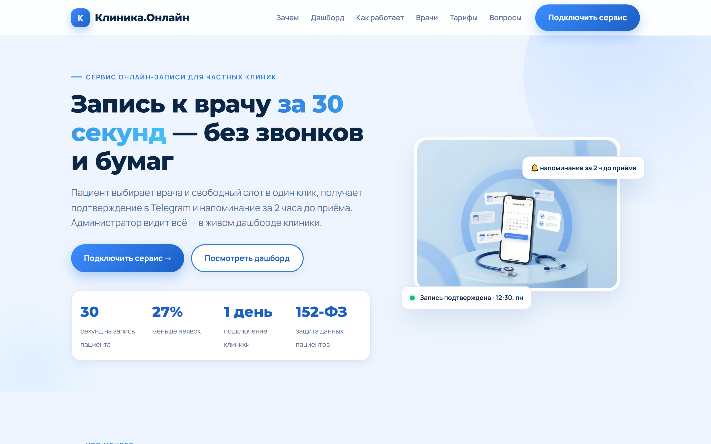
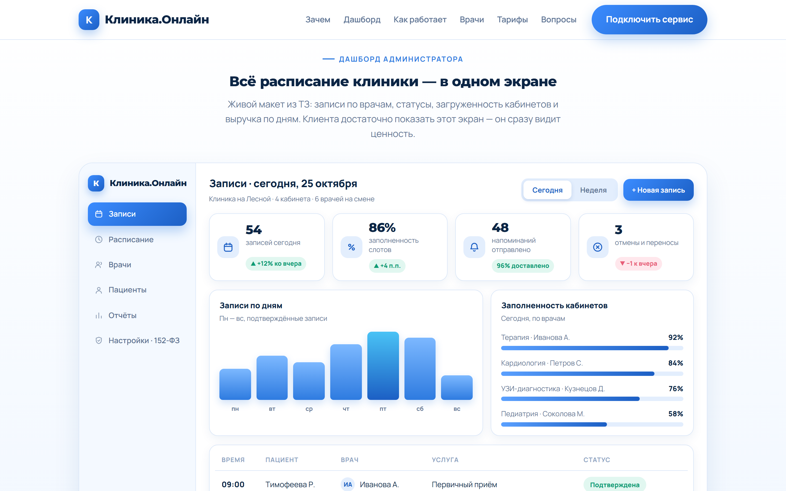
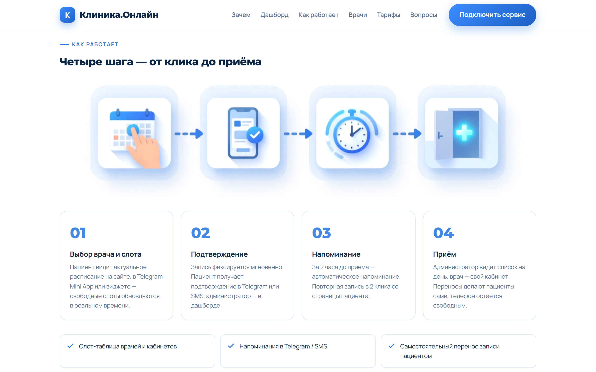
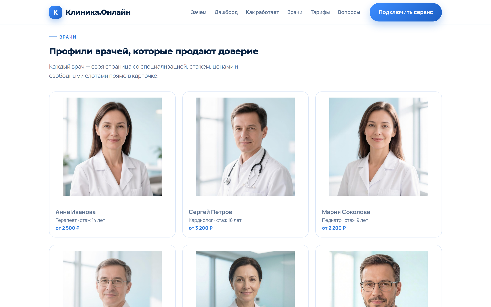
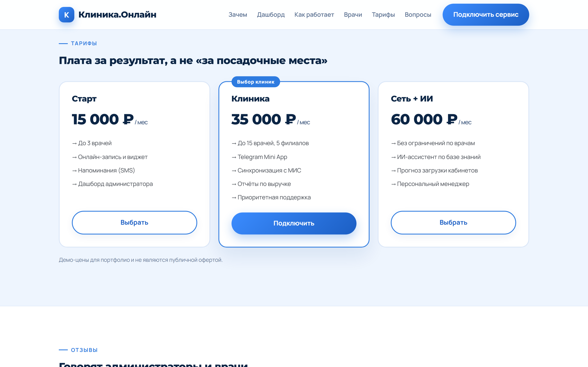
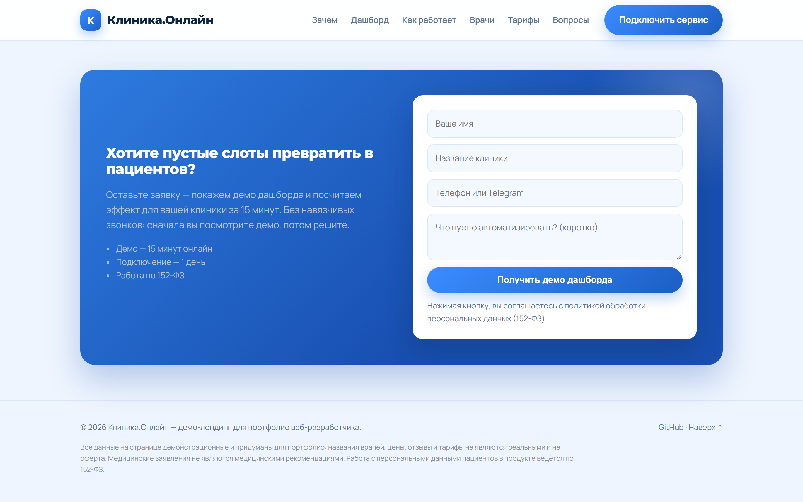

# Клиника.Онлайн — лендинг сервиса онлайн-записи к врачу + дашборд администратора

> **Live demo: [https://Mary-RND.github.io/klinika-online-landing/](https://Mary-RND.github.io/klinika-online-landing/)** · Кейс для портфолио: заказ с freelance.ru — дизайн + вёрстка
> главной страницы SaaS-сервиса для частных клиник с наглядным макетом дашборда.



## Что это за работа

Продающий B2B-лендинг сервиса онлайн-записи: пациент выбирает врача и слот за 30 секунд,
получает подтверждение в Telegram и напоминание за 2 часа до приёма. Администратор клиники
видит расписание, загрузку кабинетов и выручку в одном экране — **живом дашборде, свёрстанном
на чистом CSS** (не картинка: клиенту можно показать работающий интерфейс).

| | |
|---|---|
| **Задача** | дизайн главной страницы + наглядный макет дашборда |
| **Роль** | дизайн, HTML/CSS/JS-вёрстка под ключ, генерация визуалов по промптам |
| **Срок** | 1 день (по заказу отведено 5) |
| **Стек** | HTML, CSS (Grid/Flexbox), ванильный JS, Google Fonts, AI-генерация картинок |

## Дашборд — центр экрана заказчика



- светлый сайдбар с иконками и статусом синхронизации с МИС;
- 4 KPI-карточки с дельтами, гистограмма записей по дням, прогресс-бары заполненности кабинетов;
- таблица записей с аватар-инициалами врачей и цветными статусами;
- переключатель «Сегодня / Неделя», кнопка «+ Новая запись»;
- адаптив: планшет и мобильные.

## Ещё секции

| Схема из 4 шагов | Врачи |
|---|---|
|  |  |

| Тарифы | Форма заявки |
|---|---|
|  |  |

## Дизайн-система

- **Палитра:** белый `#FFFFFF` и светло-голубой `#EEF5FE` · синий акцент `#2E7BE0`
  (градиент `#3B8CFF → #1C5FC4`) · тёмно-синий текст `#0B2545`;
- **Шрифты:** Montserrat 800 (заголовки) + Manrope (интерфейс);
- **Компоненты:** карточки со скруглением 16–26 px и мягкими тенями, синие плашки-иконки,
  пилюли-кнопки, декоративные круги-градиенты в hero;
- **Картинки:** 12 изображений сгенерированы по промптам (Midjourney/FLUX-стиль),
  портреты врачей — фотореалистичные, схема — векторная иллюстрация.

## Структура

```
index.html          — лендинг целиком (HTML + CSS + JS в одном файле)
img/                — 12 визуалов: hero, схема, 6 врачей, 3 аватарки, OG-обложка
screenshots/        — скриншоты всех секций + полная страница
```

## Запуск локально

```bash
git clone https://github.com/Mary-RND/klinika-online-landing.git
cd klinika-online-landing
python -m http.server 8080   # и открыть http://localhost:8080
```

---

**Дисклеймер:** демо-макет для портфолио. Все названия врачей, цены, отзывы и тарифы
вымышлены и не являются офертой. Работа с персональными данными пациентов ведётся по 152-ФЗ.

Контакты: [Mary-RND](https://github.com/Mary-RND)
